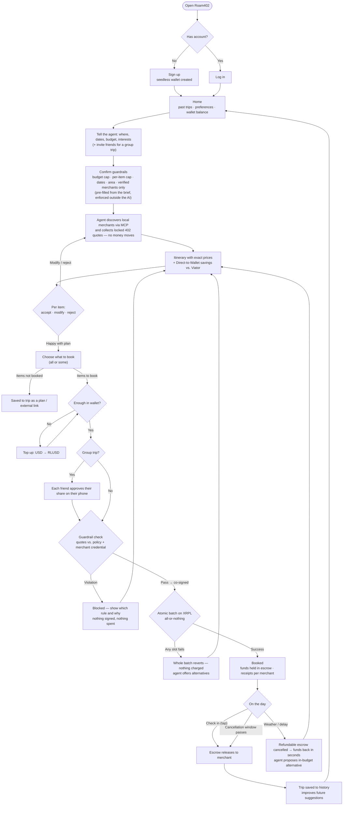

# Roam402 — User Flow

Revised from the whiteboard sketch. Main change: **prices are locked and guardrails are set before the user says "book"**, and settlement happens through escrow rather than by both sides agreeing manually.

## Steps

| # | Step | What changed vs. sketch | Owner |
|---|---|---|---|
| 1 | Sign up / log in → home | Wallet created at signup; history shows balance too | B (gateway) / D |
| 2 | Brief the agent | Unchanged; group invite added | B / D |
| 3 | **Confirm guardrails** | **New.** Budget becomes a hard on-ledger rule, not just a sentence to the LLM | A (guardrail) / D |
| 4 | Discover + locked quotes | **New.** Suggestions carry real, signed prices before acceptance | A (merchants) / B |
| 5 | Accept / modify / reject loop | Now per item, and every iteration re-quotes | B / D |
| 6 | Choose what to book | Replaces yes/no: users can book a subset; the rest is saved | D |
| 7 | Wallet check / top-up | **New.** "Funds in wallet" needed a way in | C / D |
| 8 | Group approval | **New.** Each friend signs their share | C (stretch) |
| 9 | Guardrail check | **New.** Failure path back to review with reasons | A |
| 10 | Atomic batch | **New.** Failure path: everything reverts, nothing charged | C |
| 11 | Escrow → release | Replaces "both want to settle": releases on check-in or when the cancellation window passes | C / A |
| 12 | Disruption pivot | **New.** Refund + re-plan loop | B / C |
| 13 | Save to history | Closes the loop with step 1 | B |

## MVP scope (36h demo)

Steps 1, 7 and 8 are slideware. The demo starts logged in with a pre-funded wallet. Steps 2–6 and 9–12 are the live
demo: happy path, the **Malicious Upsell** button (step 9 blocked) and the **Rainstorm** button (step 12).
